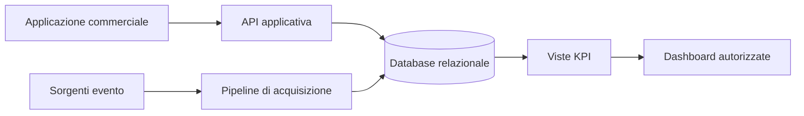

# EVVENTIA

EVVENTIA è un progetto didattico per la gestione commerciale e l'analisi dei flussi di un evento. Il repository pubblico descrive una soluzione realizzabile e verificabile mantenendo separati documentazione, ambienti operativi e dati riservati.

## Obiettivo

Collegare tre capacità principali:

- gestione del percorso commerciale, dallo stand al contratto;
- acquisizione e governo dei dati dell'evento;
- indicatori aggregati per staff ed espositori autorizzati.

## Contenuto pubblico

Questa prima versione contiene esclusivamente:

- architettura di riferimento;
- principi del modello dati e della sicurezza;
- roadmap per Gate;
- regole di governo e pubblicazione.

Non contiene codice applicativo, esportazioni Power Apps, credenziali, URL operativi, dati cliente o documentazione di assegnazione individuale.

## Architettura in breve

La soluzione adotta un database relazionale come fonte unica dei dati governati. L'interfaccia applicativa e i processi di caricamento accedono allo stesso modello tramite contratti versionati.

I riferimenti operativi sono espressi con placeholder, per esempio:

- `[API_BASE_URL]`
- `[ENVIRONMENT_NAME]`
- `[SECURITY_CONTACT]`

## Stato per Gate

| Gate | Risultato | Stato |
|---|---|---|
| G1 | Contratto, modello dati, KPI e controllo accessi | Superato |
| G2 | Percorso commerciale e dati storici verificabili | In corso |
| G3 | Vertical slice evento e dashboard | Pianificato |
| G4 | Qualità, privacy e hardening | Pianificato |
| G5 | Demo riproducibile | Pianificato |

## Documentazione

- [Architettura](docs/ARCHITECTURE.md)
- [Dati e privacy](docs/DATA_AND_PRIVACY.md)
- [Governance](docs/GOVERNANCE.md)
- [Roadmap](docs/ROADMAP.md)
- [Politica di pubblicazione](PUBLICATION_POLICY.md)

## Nota di sicurezza

Tutti gli esempi devono usare dati sintetici. Eventuali segnalazioni di sicurezza devono essere inviate a `[SECURITY_CONTACT]` senza pubblicare dettagli sensibili in una issue.
