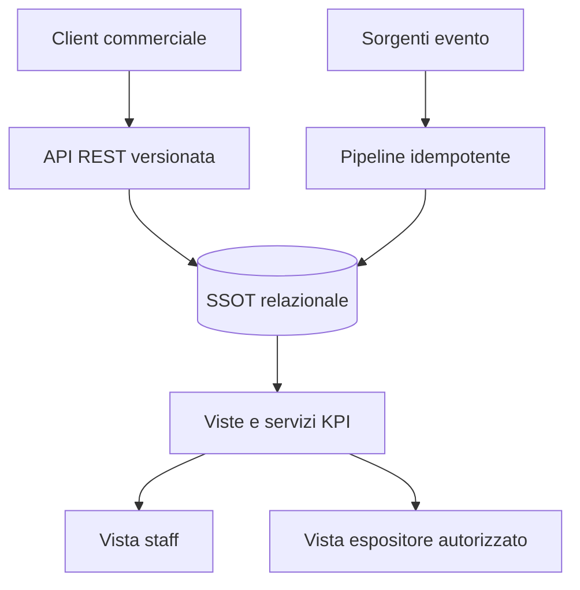

# Architettura di riferimento

## Principi

1. Una sola fonte relazionale per i dati governati.
2. Contratti API versionati tra applicazione e servizi.
3. Caricamenti ripetibili e idempotenti.
4. KPI calcolati da fatti tracciabili, con periodo e granularità dichiarati.
5. Autorizzazione applicata prima dell'esposizione dei dati.
6. Componenti sostituibili senza dipendere da uno specifico provider.

## Componenti

### Client commerciale

Gestisce il percorso evento → espositore → stand → preventivo → contratto → acconto. Non contiene regole economiche duplicate: calcoli e validazioni definitive appartengono al servizio applicativo.

### API applicativa

Espone operazioni versionate sotto `[API_BASE_URL]`. Applica autenticazione, autorizzazione, validazione e gestione coerente degli errori.

### SSOT relazionale

Conserva entità commerciali, eventi e misure aggregate. Chiavi e relazioni sono stabili all'interno dell'edizione dell'evento.

### Pipeline dati

Importa le sorgenti in modo ripetibile, registra conteggi ed errori e impedisce duplicazioni. Le anomalie non vengono corrette silenziosamente.

### KPI e dashboard

Le viste KPI derivano dagli stessi fatti governati. Ogni indicatore dichiara periodo, granularità e regola di calcolo; le viste non espongono identificativi personali grezzi.

## Flusso di riferimento

1. Il client richiede o registra un'operazione commerciale.
2. L'API valida ruolo, dati e regole di business.
3. Il database conserva la versione governata del fatto.
4. La pipeline aggiunge i dati storici o operativi con log di esecuzione.
5. Le viste KPI producono risultati riconciliabili.
6. La dashboard espone soltanto le informazioni autorizzate.
