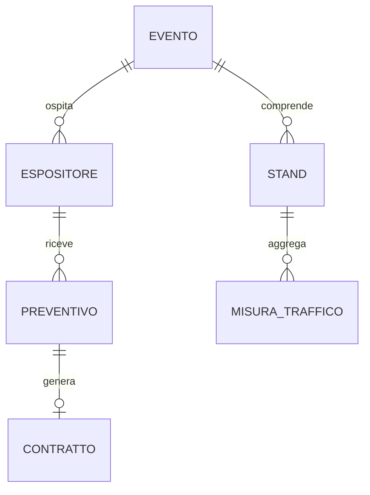

# Dati e privacy

## Regole pubbliche

- Nessun dato cliente o record personale viene incluso nel repository.
- Gli esempi utilizzano identificativi sintetici come `[EVENT_ID]`, `[EXHIBITOR_ID]` e `[STAND_ID]`.
- Email, nomi, telefoni e identificativi tecnici di ambiente non sono necessari alla documentazione architetturale.
- I KPI pubblici sono aggregati e non consentono di ricostruire il comportamento di una persona.
- I dati di test devono essere chiaramente etichettati come sintetici.

## Modello concettuale

Ogni record è circoscritto a un evento. La versione accettata del preventivo è immutabile; il contratto la riferisce senza riscriverla. Le misure di traffico sono aggregate per stand, periodo e granularità dichiarata.
